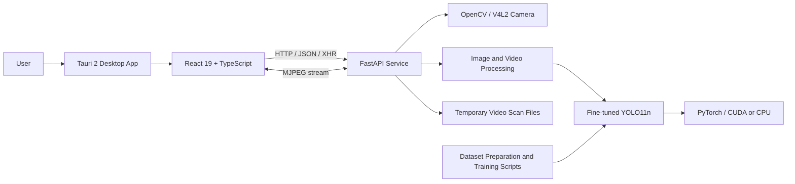
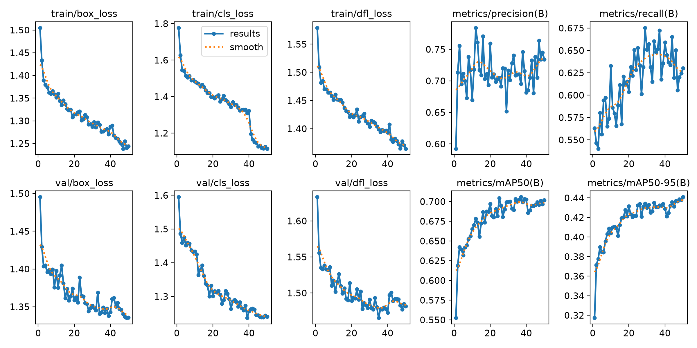
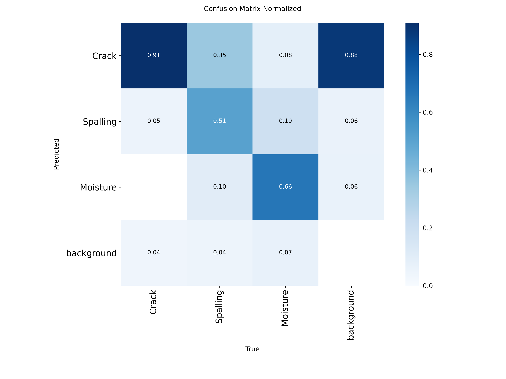

# CUBIT Inspect

**AI Specialization Project**  
**UAV-Assisted Infrastructure Defect Detection and Inspection**

CUBIT Inspect is a local desktop inspection application backed by a fine-tuned YOLO11n object detector. It is designed to help inspect infrastructure imagery and video captured from unmanned aerial vehicles (UAVs) or other imaging sources, with a focus on three visible defect categories: **Crack**, **Spalling**, and **Moisture**.

The repository combines the model-training and evaluation workflow with a desktop interface and a local inference API.

<p align="center">
  <strong>Student</strong><br/>
  Prasangeet Dongre
  <br/><br/>
  <strong>Instructor</strong><br/>
  Prof. Santhosh Kumar Varanasi
</p>

---

## Table of contents

- [Project overview](#project-overview)
- [Objectives](#objectives)
- [Implemented capabilities](#implemented-capabilities)
- [System architecture](#system-architecture)
- [Technology stack](#technology-stack)
- [Repository structure](#repository-structure)
- [Getting started](#getting-started)
- [Configuration](#configuration)
- [Using CUBIT Inspect](#using-cubit-inspect)
- [Backend API](#backend-api)
- [Dataset and preparation workflow](#dataset-and-preparation-workflow)
- [Model training](#model-training)
- [Evaluation and recorded results](#evaluation-and-recorded-results)
- [Command-line inference](#command-line-inference)
- [Known limitations](#known-limitations)
- [Dataset, attribution, and licensing](#dataset-attribution-and-licensing)
- [Acknowledgements](#acknowledgements)

---

## Project overview

Infrastructure defects such as cracks, concrete spalling, and moisture-related damage can be difficult to identify consistently across large collections of inspection imagery. UAV-based imaging can provide visual access to infrastructure surfaces, while object-detection models can help highlight candidate defect regions for subsequent human review.

CUBIT Inspect brings these pieces into one workflow:

1. Capture a live camera feed or select an image/video file.
2. Run the selected input through a locally hosted YOLO11n inference service.
3. Visualize detected defect classes and confidence values.
4. For video scans, inspect processing progress and preview the annotated output.
5. Use the accompanying scripts to download, prepare, train, and evaluate the detector.

The application performs inference locally through a FastAPI service running on the same machine as the desktop client. It does not require a hosted inference API.

### Detection classes

| Class ID | Defect class | Description |
|---:|---|---|
| 0 | Crack | Visible crack-like surface defects |
| 1 | Spalling | Visible concrete or surface material loss |
| 2 | Moisture | Visible moisture-related surface regions |

The class names and IDs are fixed in the current application and model workflow.

## Objectives

- Develop a desktop interface for infrastructure image and video inspection.
- Integrate a fine-tuned YOLO11n object detector into a local inference service.
- Support live camera, still-image, and video inference workflows.
- Provide configurable confidence and inference-resolution settings.
- Report class-wise detection counts and confidence information.
- Maintain a reproducible dataset preparation, training, and evaluation workflow.
- Keep inference and media processing on the local machine.

## Implemented capabilities

### Live camera inspection

- Discovers Linux video devices through `/dev/video*` rather than assuming that the camera is always device index `0`.
- Reads device names from Linux sysfs and probes whether each device can return a frame.
- Captures frames with OpenCV and runs YOLO inference in a worker thread.
- Streams annotated frames to the desktop UI through an MJPEG endpoint.
- Displays the current detections and an estimated frame rate.

**Platform note:** camera discovery and capture currently use Linux V4L2 device nodes. This workflow is Linux-specific in the current backend implementation.

### Image analysis

- Select a local image from the desktop application.
- Run inference using the selected confidence threshold and image size.
- Return an annotated JPEG image and the detected class/confidence values.
- Display the annotated image and detection list in the interface.

The command-line image inference utility supports JPG, JPEG, PNG, BMP, TIFF, and WebP inputs.

### Video analysis

- Select a local video and review its filename, size, confidence threshold, and inference resolution before scanning.
- Upload the video to the local API with upload-progress reporting.
- Process the video asynchronously and poll job status for frame-level progress.
- Generate an annotated MP4 output.
- Report total detections, class counts, average class confidence, frames processed, frames analysed, frame rate, dimensions, and duration.
- Preview the source video and completed annotated video from the interface.

Supported video extensions in the API include MP4, MOV, M4V, AVI, MKV, WebM, MPG, and MPEG.

To limit sustained compute usage, the API analyses every second frame by default. The most recent annotated frame is reused for intervening frames in the output video. This preserves the output frame rate but can miss short-lived defects that appear only between sampled frames. Set `CUBIT_VIDEO_FRAME_STRIDE=1` to analyse every frame.

### Configurable inference settings

The desktop interface exposes:

- **Confidence threshold:** minimum detector confidence; the UI control ranges from `0.05` to `0.90`.
- **Input resolution:** `640`, `800`, or `1024` pixels.

The API accepts a wider range of values, subject to request validation. Higher input resolutions and denser video sampling generally increase compute cost.

---

## System architecture

The desktop frontend and inference service are separate processes. Start the backend first, then launch the Tauri application.



### Runtime flow

**Live camera**

`V4L2 device → OpenCV capture → YOLO inference → annotated JPEG frames → MJPEG stream → React UI`

**Image**

`Selected image → multipart upload → FastAPI → OpenCV decode → YOLO inference → annotated JPEG response → React UI`

**Video**

`Selected video → multipart upload → job creation → background processing thread → sampled-frame inference → annotated MP4 → status polling and result preview`

The backend serializes access to the shared YOLO model with a lock. Blocking image processing is dispatched to a worker thread, while video scans run in a dedicated background thread.

## Technology stack

| Layer | Technologies |
|---|---|
| Desktop shell | Tauri 2, Rust |
| Frontend | React 19, TypeScript, Vite 8 |
| Backend API | Python 3.11+, FastAPI, Uvicorn |
| Object detection | Ultralytics YOLO11n |
| Deep learning runtime | PyTorch; CUDA when available/configured, otherwise CPU |
| Image and video processing | OpenCV, NumPy |
| Python environment and dependencies | uv |
| JavaScript package manager | pnpm |

---

## Repository structure

```text
UAV-infra/
├── README.md
├── client/
│   ├── src/
│   │   ├── App.tsx                 # Main inspection interface and workflows
│   │   ├── App.css                 # Application styling
│   │   ├── VideoAnalysis.css       # Video workflow styling
│   │   └── main.tsx                # React entry point and error boundary
│   ├── src-tauri/
│   │   ├── src/                    # Tauri/Rust application entry points
│   │   ├── capabilities/           # Tauri permissions
│   │   └── tauri.conf.json         # Desktop application configuration
│   ├── package.json
│   └── vite.config.ts
│
└── server/
    ├── main.py                     # Canonical API launcher (127.0.0.1:8001)
    ├── pyproject.toml
    ├── .env.example
    ├── src/
    │   ├── api/
    │   │   ├── app.py              # FastAPI routes, camera worker, video jobs
    │   │   └── run.py              # Alternate API launcher (port 8000)
    │   ├── inference/
    │   │   ├── infer_image.py      # Image inference CLI
    │   │   └── infer_video.py      # Video inference CLI
    │   ├── training/
    │   │   ├── train_yolo.py       # YOLO training entry point
    │   │   └── evaluate_yolo.py    # Fixed-configuration evaluation script
    │   └── evaluation/
    │       └── evaluate.py        # Configurable evaluation entry point
    ├── scripts/
    │   ├── dataset_download.py    # Download official CUBIT-Det archives
    │   ├── extract_cubit_det.py   # Verify and safely extract archives
    │   ├── tile_cubit_det.py      # Generate overlapping image tiles
    │   └── visualize_cubit_det.py # Inspect labels and dataset distributions
    ├── reports/                    # Dataset visualization reports
    ├── runs/                       # Tracked training/evaluation artifacts
    ├── captures/                   # Example image/video captures
    └── *.pt                        # YOLO checkpoints
```

The dataset directory is excluded by `server/.gitignore`. The current repository snapshot does, however, contain model checkpoints, training/evaluation artifacts, visualization reports, and example media under `server/captures/`.

---

## Getting started

### Prerequisites

Install the following tools before setting up the project:

- Git
- Python 3.11 or newer
- [uv](https://docs.astral.sh/uv/)
- Node.js and [pnpm](https://pnpm.io/)
- Rust toolchain required by [Tauri 2](https://v2.tauri.app/start/prerequisites/)
- The native Tauri/WebKit dependencies required by your operating system

For GPU inference, install a PyTorch build compatible with the machine's NVIDIA driver and CUDA environment. The backend can also run on CPU, although inference will generally be slower.

On Linux, camera access requires a working V4L2 device and read/write permission for the selected `/dev/video*` node. Linux WebView video playback also depends on the media codecs and GStreamer plugins available to the system.

### 1. Clone the repository

```bash
git clone https://github.com/prasangeet/UAV-infra.git
cd UAV-infra
```

### 2. Set up and start the backend

```bash
cd server
uv sync
```

The current repository includes the fine-tuned checkpoint at:

`server/runs/detect/cubit_det_yolo11n_1024_finetune50/weights/best.pt`

The API uses that checkpoint by default. To select a different checkpoint or device, set environment variables before launching the service.

**Fish shell**

```fish
set -gx CUBIT_MODEL "$PWD/runs/detect/cubit_det_yolo11n_1024_finetune50/weights/best.pt"
set -gx CUBIT_DEVICE "0"
uv run main.py
```

Use `set -gx CUBIT_DEVICE "cpu"` to force CPU inference.

**Bash / Zsh**

```bash
export CUBIT_MODEL="$PWD/runs/detect/cubit_det_yolo11n_1024_finetune50/weights/best.pt"
export CUBIT_DEVICE="0"
uv run main.py
```

The canonical launcher starts the API at:

`http://127.0.0.1:8001`

Keep this terminal running.

### 3. Set up and launch the desktop client

Open a second terminal:

```bash
cd client
pnpm install
pnpm tauri dev
```

The Tauri development configuration starts Vite on port `1420`. The frontend defaults to the backend URL `http://127.0.0.1:8001`.

### 4. Check the backend

Open the following local URLs in a browser:

| URL | Purpose |
|---|---|
| `http://127.0.0.1:8001/api/health` | Backend and checkpoint health |
| `http://127.0.0.1:8001/api/model` | Active model and class information |
| `http://127.0.0.1:8001/docs` | Interactive FastAPI documentation |
| `http://127.0.0.1:8001/openapi.json` | Registered API schema |

A healthy API response does not necessarily mean that the model has already been loaded into memory. The health endpoint reports both checkpoint existence and model-loaded status.

### Production build

From the client directory:

```bash
pnpm build
pnpm tauri build
```

The Tauri bundle output is generated by the configured Tauri build process. The FastAPI backend is not packaged or launched as a Tauri sidecar by the current configuration; it must be started separately.

---

## Configuration

The backend reads these environment variables:

| Variable | Default | Description |
|---|---:|---|
| `CUBIT_MODEL` | `server/runs/detect/cubit_det_yolo11n_1024_finetune50/weights/best.pt` | Path to the YOLO checkpoint |
| `CUBIT_DEVICE` | `0` when CUDA is available, otherwise `cpu` | CUDA device index or `cpu` |
| `CUBIT_MAX_UPLOAD_MB` | `100` | Maximum accepted image/video upload size in MiB |
| `CUBIT_VIDEO_FRAME_STRIDE` | `2` | Run video inference on every Nth frame |
| `CUBIT_TORCH_THREADS` | `4` | PyTorch CPU intra-op thread limit; OpenCV is also limited based on this value |

A starter template is provided in `server/.env.example`. The backend currently reads configuration from the process environment; the example file is not automatically loaded as a dotenv file.

### Changing the API URL

The frontend uses:

`VITE_API_URL`

If the API is intentionally started on another port, configure the frontend before starting Vite. For example, the alternate `cubit-api` entry point defined in `pyproject.toml` uses port `8000`:

```bash
# From client/
VITE_API_URL=http://127.0.0.1:8000 pnpm tauri dev
```

For the normal setup, use `uv run main.py` and leave the frontend URL at its default port `8001`.

---

## Using CUBIT Inspect

1. Start the FastAPI service.
2. Launch the desktop application.
3. Check the AI Engine status in the left sidebar.
4. Choose one of the available input modes:
   - **Camera:** refresh the camera list, select a usable device, and start capture.
   - **Image:** select a supported image and run inference.
   - **Video:** select a video, review the scan settings, and confirm the scan.
5. Review the annotated output and defect detections.
6. For a completed video scan, preview the annotated video and confirm the results for the current session.

The video result confirmation is a session-level acknowledgement. It does not export a report or create a permanent inspection record.

---

## Backend API

The API is served locally by FastAPI. The following routes are registered in `server/src/api/app.py`.

### Health and model

| Method | Endpoint | Purpose |
|---|---|---|
| `GET` | `/api/health` | Service, checkpoint, device, and CUDA status |
| `GET` | `/api/model` | Checkpoint path and detector class names |

### Camera

| Method | Endpoint | Purpose |
|---|---|---|
| `GET` | `/api/cameras` | Discover and probe Linux camera devices |
| `POST` | `/api/camera/start` | Start capture and live inference |
| `POST` | `/api/camera/stop` | Stop the camera worker |
| `GET` | `/api/camera/status` | Read latest detections, FPS, and capture state |
| `GET` | `/api/camera/stream` | Receive annotated MJPEG frames |

The start route accepts `device`, `conf`, and `imgsz` query parameters. Example:

```text
POST /api/camera/start?device=/dev/video2&conf=0.25&imgsz=1024
```

### Image inference

| Method | Endpoint | Purpose |
|---|---|---|
| `POST` | `/api/infer/image` | Accept a multipart image upload and return annotated JPEG data plus detections |

Optional query parameters: `conf` and `imgsz`.

### Video inference

| Method | Endpoint | Purpose |
|---|---|---|
| `POST` | `/api/infer/video` | Upload a video and create an asynchronous scan job; returns HTTP `202` |
| `GET` | `/api/infer/video/{job_id}` | Read the scan state and frame progress |
| `GET` | `/api/infer/video/{job_id}/result` | Download/stream the annotated MP4 after completion |

Video job states include `queued`, `loading_model`, `processing`, `completed`, and `failed`.

Video job metadata is held in server memory, and temporary scan files are created under the operating system's temporary directory. The uploaded source file is removed after processing. Jobs are not persisted across backend restarts.

---

## Dataset and preparation workflow

### CUBIT-Det

The dataset downloader references the official CUBIT project and its CUBIT-Det dataset release:

- Official project: [Benyun Zhao et al. — CUBIT](https://github.com/BenyunZhao/CUBIT)
- Dataset paper: [High-resolution infrastructure defect detection dataset sourced by unmanned systems and validated with deep learning](https://doi.org/10.1016/j.autcon.2024.105405)
- Dataset source folder: [CUBIT-Det on Google Drive](https://drive.google.com/drive/folders/1-20JAwuyyd1-Fbpa8f8jHUwtI5B0Frx5)

The source note in `dataset_download.py` describes 5,527 UAV images from building, pavement, and bridge scenes, with bounding-box annotations for Crack, Spalling, and Moisture.

### Download and extract

Run from the `server/` directory:

```bash
uv sync
uv run --with gdown python scripts/dataset_download.py
uv run python scripts/extract_cubit_det.py --verify-only
uv run python scripts/extract_cubit_det.py
```

The downloader places the original archives under `data/cubit_det_raw/`. The extractor expects six archives covering image and label groups for train, validation, and test. It verifies archive integrity and member paths before extraction.

The extraction script writes the prepared source data under `data/cubit_det/`. The training script expects a YOLO dataset YAML at `data/cubit_det/data.yaml`; create or verify this file against the extracted directory layout before training. A typical configuration is:

```yaml
path: /absolute/path/to/UAV-infra/server/data/cubit_det
train: images/train2017/train2017
val: images/val2017/val2017
test: images/test2017/test2017

names:
  0: Crack
  1: Spalling
  2: Moisture
```

Adjust the image paths if the downloaded archive structure differs.

### Dataset inspection

The committed original-dataset visualization report records the following inventory:

| Split | Images | Images with boxes | Bounding boxes |
|---|---:|---:|---:|
| Train | 3,980 | 3,980 | 12,001 |
| Validation | 442 | 442 | 1,326 |
| Test | 1,105 | 1,104 | 3,457 |
| **Total** | **5,527** | **5,526** | **16,784** |

The visualization audit reports two invalid annotation rows in the training split and one in validation. It is explicitly an exploratory visualization, not a complete annotation audit.

See:
- [Original dataset visualization report](server/reports/cubit_det_visualization/report.md)
- [Class distribution](server/reports/cubit_det_visualization/class_distribution.png)
- [Split distribution](server/reports/cubit_det_visualization/split_distribution.png)

### Optional high-resolution tiling

The repository also includes `scripts/tile_cubit_det.py`, which generates YOLO-format tiles from the original images.

Default parameters:

- Tile size: `640 × 640`
- Overlap: `20%`
- Minimum visible fraction of an object: `30%`
- Up to two randomly selected background tiles per source image
- Random seed: `42`

Example:

```bash
uv run python scripts/tile_cubit_det.py
uv run python scripts/visualize_cubit_det.py
```

The committed tiled-dataset report records:

| Split | Tiles | Tiles with boxes | Bounding-box instances |
|---|---:|---:|---:|
| Train | 23,183 | 15,223 | 18,174 |
| Validation | 2,561 | 1,677 | 1,942 |
| Test | 6,653 | 4,443 | 5,356 |
| **Total** | **32,397** | **21,343** | **25,472** |

These are tile-level instances; overlapping crops can contain the same source object more than once.

The tiled report's aggregate class distribution is:

| Class | Tile-level instances |
|---|---:|
| Crack | 20,992 |
| Spalling | 2,827 |
| Moisture | 1,653 |

See:
- [Tiled dataset visualization report](server/reports/cubit_det_tiled_visualization/report.md)
- [Tiled class distribution](server/reports/cubit_det_tiled_visualization/class_distribution.png)
- [Tiled split distribution](server/reports/cubit_det_tiled_visualization/split_distribution.png)

**Training note:** `train_yolo.py` defaults to the original, non-tiled dataset YAML at `data/cubit_det/data.yaml`. To train on tiled data, create a separate YAML that points to `data/cubit_det_tiled/images/{train,val,test}` and pass it with `--data`.

---

## Model training

The training entry point is `server/src/training/train_yolo.py`. It uses Ultralytics YOLO and exposes command-line options for the model checkpoint, dataset YAML, epochs, image size, batch size, device, optimizer, learning rate, augmentation, and output directory.

The script's conservative defaults include:

- Image size: `1024`
- Batch size: `2`
- Epochs: `50`
- Patience: `10`
- Optimizer: `AdamW`
- Initial learning rate: `0.001`
- Seed: `42`
- CUDA device: `0`

Run from `server/` after preparing the dataset YAML:

```bash
uv run python -m src.training.train_yolo   --model yolo11n.pt   --data data/cubit_det/data.yaml   --imgsz 1024   --batch 2   --device 0   --workers 2   --epochs 50   --name cubit_det_yolo11n_experiment
```

Use `--device cpu` when training without CUDA. Choose a new `--name` for each fresh run; the training script refuses to overwrite an existing run directory. The `--resume` option resumes the selected run from its `weights/last.pt` checkpoint.

Training outputs are written under `runs/detect/{run-name}/`, including weights, plots, and a results CSV.

### Fine-tuned checkpoint

The API's default checkpoint is:

`runs/detect/cubit_det_yolo11n_1024_finetune50/weights/best.pt`

The tracked training configuration indicates that this run was initialized from the earlier `cubit_det_yolo11n_1024-2/weights/best.pt` checkpoint and fine-tuned for 50 epochs at 1024-pixel input resolution.

---

## Evaluation and recorded results

Use the configurable evaluator at `server/src/evaluation/evaluate.py` to evaluate a selected checkpoint on the training, validation, or test split.

Example test-split evaluation:

```bash
uv run python -m src.evaluation.evaluate   --model runs/detect/cubit_det_yolo11n_1024_finetune50/weights/best.pt   --data data/cubit_det/data.yaml   --split test   --imgsz 1024   --batch 2   --device 0
```

The evaluator writes:

- Ultralytics evaluation plots and predictions
- `class_metrics.csv` with per-class precision, recall, mAP50, and mAP50-95
- `evaluation_summary.json` and `evaluation_summary.txt`

### Tracked fine-tuning validation snapshot

The final row (epoch 50) of the committed `cubit_det_yolo11n_1024_finetune50/results.csv` records:

| Metric | Epoch 50 validation value |
|---|---:|
| Precision | 0.7342 |
| Recall | 0.6301 |
| mAP@50 | 0.7017 |
| mAP@50–95 | 0.4409 |

These are **validation metrics recorded during the fine-tuning run**, not held-out test-set results. They should not be presented as test performance.

### Training and evaluation visualizations





A separate validation summary is also tracked for the earlier `cubit_det_yolo11n_1024-2` checkpoint. It belongs to that earlier run and should not be conflated with the fine-tuned checkpoint's metrics.

---

## Command-line inference

The API is not required for these standalone utilities. Run the commands from `server/`.

### Image inference

```bash
uv run python -m src.inference.infer_image /path/to/image.jpg   --model runs/detect/cubit_det_yolo11n_1024_finetune50/weights/best.pt   --imgsz 1024   --conf 0.25   --device 0
```

The annotated image is saved under `runs/inference/images/` by default.

### Video inference

```bash
uv run python -m src.inference.infer_video /path/to/video.mp4   --model runs/detect/cubit_det_yolo11n_1024_finetune50/weights/best.pt   --imgsz 1024   --conf 0.25   --device 0   --vid-stride 1
```

The CLI video utility uses Ultralytics streaming prediction and saves annotated output under `runs/inference/videos/`. Its `--vid-stride` option controls sampling; the CLI default is `1` (every frame), whereas the desktop API defaults to stride `2`.

---

## Known limitations

- **Visual detection is not structural diagnosis.** Results are candidate visual detections and require review by a qualified inspector or engineer before any maintenance or safety decision.
- **Three fixed classes:** the current workflow recognises Crack, Spalling, and Moisture only.
- **Linux camera implementation:** live camera discovery is based on V4L2 `/dev/video*` nodes and sysfs.
- **Video sampling:** desktop video inference samples every second frame by default. Defects that appear only between sampled frames may be missed.
- **Local, in-memory video jobs:** video job state is not stored in a database and is lost when the backend restarts.
- **Session-only confirmation:** confirming a video scan does not create a persistent inspection history, export a report, or upload records to a remote service.
- **Temporary video processing:** source uploads are deleted after processing; annotated output is kept in the system temporary scan directory for the lifetime of the job/backend process.
- **No authentication layer:** the API is intended for a local desktop workflow and binds to loopback by default.
- **Hardware dependency:** inference speed and feasible resolution depend on available CPU/GPU memory and the selected model settings.
- **Codec dependency:** media playback in the Linux WebView depends on the codecs and GStreamer plugins installed on the host system.

---

## Dataset, attribution, and licensing

CUBIT-Det is attributed in the repository's dataset download script to:

> Benyun Zhao et al., “High-resolution infrastructure defect detection dataset sourced by unmanned systems and validated with deep learning,” *Automation in Construction*, Volume 163 (2024), Article 105405.  
> [https://doi.org/10.1016/j.autcon.2024.105405](https://doi.org/10.1016/j.autcon.2024.105405)

The downloader's source note states that the dataset authors specify **Creative Commons Attribution 4.0 International (CC BY 4.0)**. Review the dataset authors' terms and attribution requirements before redistributing the data.

The repository does not currently include a top-level project `LICENSE` file. The dataset's stated license should not be interpreted as a license for this project's source code, model weights, or example capture media. Check the applicable upstream licenses and permissions before reusing or redistributing those materials.

The raw dataset is not committed to the repository. The current repository snapshot does include model weights, experiment outputs, plots, reports, and example files in `server/captures/`.

---

## Acknowledgements

- The authors and contributors of the [CUBIT project](https://github.com/BenyunZhao/CUBIT) for the CUBIT-Det dataset.
- The [Ultralytics](https://github.com/ultralytics/ultralytics) team for the YOLO training and inference framework.
- The maintainers of FastAPI, OpenCV, PyTorch, React, Vite, Tauri, and the Rust ecosystem.

---

<p align="center">
  <strong>CUBIT Inspect · AI Specialization Project</strong><br/>
  Prasangeet Dongre · Instructor: Prof. Santhosh Kumar Varanasi
</p>
